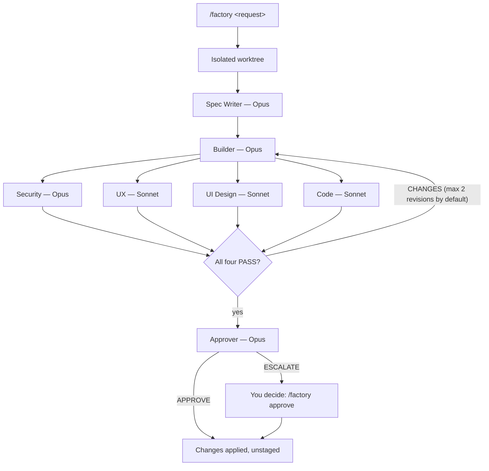

# Software Factory for Claude Code

A local, visual software factory as a Claude Code plugin. `/factory <feature request>` turns a request into a specification and plan, an implementation in an isolated Git worktree, four parallel reviews, up to two automatic revision rounds (configurable) and an approval. The approved changes then land on your branch **uncommitted and unstaged**, ready for you to review and commit.

A localhost dashboard shows every stage, every agent's token usage and every file the run produced.



Not an official Anthropic project.

## Install

### One command

From the repository you want to use it in:

```sh
bash <(curl -fsSL https://raw.githubusercontent.com/Petrit-Halabaku/software-factory/main/install.sh)
```

The script adds the four marketplaces, installs or enables the factory and its six dependencies, and runs the factory's plugin check. It then sets the repository up: exclusions, `factory/`, and a Claude Code session that writes `factory/house-rules.md` with you. It is safe to run again; whatever is already there is kept.

| Option | Effect |
|---|---|
| `--repo PATH` | set up another repository instead of the current directory |
| `--headless` | write the house rules without an interactive session; anything it could not confirm with you is marked `UNCONFIRMED` |
| `--install-only` | install the plugins and stop |

It installs at user scope into the Claude Code profile in use (`CLAUDE_CONFIG_DIR`, or `~/.claude`), and needs `claude`, `git` and Node.js 20 or later.

### By hand

The factory depends on six other plugins. Claude Code installs them with it, as long as their marketplaces are added first:

```sh
claude plugin marketplace add anthropics/claude-plugins-official   # usually already added
claude plugin marketplace add forrestchang/andrej-karpathy-skills
claude plugin marketplace add Lum1104/Understand-Anything
claude plugin marketplace add Petrit-Halabaku/software-factory
claude plugin install factory@software-factory
```

Then run `/reload-plugins`, or start a new Claude Code session, and continue with [Set up a repository](#set-up-a-repository).

| Dependency | Used for |
|---|---|
| `superpowers` | brainstorming, plans, test-driven development, debugging, verification, receiving reviews |
| `feature-dev` | read-only helper agents: code explorer, code architect, second-opinion code reviewer |
| `frontend-design` | UI work and the UI design review |
| `andrej-karpathy-skills` | keeping changes small and assumptions explicit |
| `understand-anything` | optional codebase knowledge graph for impact analysis |
| `claude-code-setup` | installed for you; no factory stage uses it |

If one is missing or disabled later, `/factory` notices at the start of a run, installs or enables it, and asks you to reload.

**Requirements:** Claude Code with plugin dependencies and agent skill preloading (tested with 2.1.306), Git with worktree support, Node.js 20 or later, macOS or Linux.

## Set up a repository

In the repository you want to build in:

```text
/factory init
```

It adds one block to `.git/info/exclude` (never `.gitignore`), creates `factory/` for the factory's state, and writes `factory/house-rules.md` by inspecting your repository: languages and versions, test and lint commands, conventions, UI kit, auth helpers. It asks you only for what the code cannot say, such as paths that must never change. Edit `factory/house-rules.md` whenever the repository changes; every agent reads it before working.

## Use

| Command | What it does |
|---|---|
| `/factory init` | sets the factory up in the current repository |
| `/factory <feature request>` | starts a run |
| `/factory status` | run, stage, agents, reviews, revisions, approval, files, tokens, dashboard URL |
| `/factory approve [note]` | approves an escalated run and applies it after the Git safety checks |

If another skill in your setup is also called `factory`, use the plugin's full name: `/factory:factory init`.

The dashboard runs at `http://127.0.0.1:4100/` (or the `dashboard.port` you set) and starts with the first run. Before it gives you the address, the factory checks that the dashboard on that port serves this repository; if another program or another repository's dashboard holds the port, it uses the next free one of the two after it. Specs, plans, build reports, reviews, approvals and every changed file open in a side drawer: Markdown preview, source with line numbers, diffs against the start or any earlier round.

## How it works

| Stage | Agent | Model | Preloaded skills | Helpers |
|---|---|---|---|---|
| Spec | `factory:spec-writer` | Opus | brainstorming, writing-plans, karpathy-guidelines, understand-explain | code-explorer, code-architect |
| Build | `factory:builder` | Opus | executing-plans, test-driven-development, systematic-debugging, verification-before-completion, receiving-code-review, karpathy-guidelines, frontend-design, simplify | none |
| Review | `factory:security` | Opus | verification-before-completion | none |
| Review | `factory:ux` | Sonnet | none | none |
| Review | `factory:ui-design` | Sonnet | frontend-design | none |
| Review | `factory:code` | Sonnet | code-review, verification-before-completion, karpathy-guidelines, understand-diff | code-reviewer |
| Approval | `factory:approver` | Opus | verification-before-completion, understand-diff | none |

The session that runs `/factory` is the orchestrator. It spawns the agents, decides from the files they write, never from their replies, and is the only thing that touches Git or the board. It does that through a small CLI (`bin/fac.mjs`), so every Git step is the same tested code.

Skills are preloaded through each agent's `skills:` frontmatter, so an agent never has to decide to use them. Where a skill would ask you a question, commit, push or open a PR, the factory's rules override it. The full rules are in [`plugins/factory/rules.md`](plugins/factory/rules.md).

## Safety

- **Your checkout is never built in.** Every run builds in `factory/worktrees/<run-id>/` on a local `factory/<run-id>` branch from your current commit. Your uncommitted changes are not part of the build: the factory lists them first, and asks before building without any that the request looks like it depends on. It refuses to commit a round if the builder touched files in your checkout.
- **Nothing reaches Git history on your branch.** Rounds are committed only on the factory branch. Merge-back checks your branch, HEAD, the worktree, the exclusions and the patch, then runs `git apply --check` and `git apply`, working tree only. Your index and HEAD are verified unchanged afterwards. Nothing is ever pushed. The `factory/<run-id>` branches are local, and their commit messages name the run; delete them once you have committed (a `git push --all` would publish them).
- **Factory files stay out of Git.** Everything lives in `factory/`, ignored through `.git/info/exclude`, and every run checks that nothing there is tracked or staged.
- **Git is the only tool that reads that exclusion.** Anything that packages or uploads the working directory by its own rules (`docker build`, `npm publish`, `vercel deploy`, `rsync`) would take `factory/` with it: your requests, the specs and reviews, patches, worktree copies of the code and token records. Each run warns when the repository has a container file without `factory/` in `.dockerignore`, or a publishable `package.json` (not private, no `files` list). For any other such tool, add `factory/` to its ignore file yourself. Do not add it to `.gitignore`: the factory's own check then fails, because it requires the exclusion to come from `.git/info/exclude`.
- **Secrets stay out.** Rounds and patches with secret-bearing files (`.env*` in any spelling, `.envrc`, `.dev.vars`, keys and certificates, `.npmrc`, `.git-credentials`, `.ssh/`, Terraform state and variables, …) or credential-looking lines (private keys, cloud, Git host, package registry, chat and AI API tokens, passwords in database URLs to remote hosts) are refused, and `/factory approve` does not override that. Reports name files and lines, never values. The patterns catch known formats, not every secret: review the diff before you commit it.
- **The dashboard is local and read-only.** It binds to 127.0.0.1, serves registered artifacts by id only, and refuses path traversal, symlinks, secret files and oversized files. It has no login: anyone or anything on the same machine can open it while it runs, so stop it (Ctrl-C) on a shared host.

## Token monitoring

The dashboard reads Claude Code's local session records for the repository, read-only, from every profile that has them (`~/.claude/projects/…`, `~/.claude-<name>/projects/…`). Usage is attributed per model, per agent (orchestrator separate), per stage and per round, for the current run, a local 5-hour window, 24 hours, 7 days or all history. Each API message counts once. Only message, session and agent ids, model names, timestamps, token counters and the paths of the record files are stored (in `factory/`), never prompt or message text. Plan quotas are shown as *Unavailable*, because no local source reports them.

## Configuration

`factory/config.json` in your repository overrides the plugin's defaults:

| Key | Default | Meaning |
|---|---|---|
| `worktree.links` | `["node_modules"]` | dependency directories symlinked into each worktree; `/factory init` writes the defaults that exist and are untracked (add others, for example `"apps/web/node_modules"`, then run `/factory init` again) |
| `revisionMax` | `2` | automatic revision rounds before escalation |
| `dashboard.port` | `4100` | dashboard port |
| `usage.sources` | found automatically | session-record directories to read |
| `usage.pricing` | `null` | USD per million tokens per model family, to show cost estimates |

## Skill finder

The marketplace also has `skill-finder`, a separate plugin with no dependencies:

```sh
claude plugin install skill-finder@software-factory
```

Ask "how do I do X", "find a skill for X" or "which skill should I use for this". It matches the task, by domain and by task, against the skills installed in your profile, your enabled plugins and the repository. It checks that each one can run here: plugin enabled, MCP server connected, binaries and credentials present (it checks that a variable is set, never its value). Skills that would work against what you asked for are listed as not loaded, with the reason. It shows a short table, asks you to choose, then runs the skill you picked. The public skills registry is searched only for parts nothing installed covers, and nothing is installed, enabled or signed in without your yes.

Its inventory also runs on its own, read-only: `node plugins/skill-finder/skills/skill-finder/scripts/inventory.mjs --query "<task>"`.

## Uninstall

```sh
claude plugin uninstall factory@software-factory
claude plugin uninstall skill-finder@software-factory   # if you installed it
```

In each repository you used it in: delete `factory/`, run `git worktree prune` (Git refuses to delete a branch that a removed worktree still claims), remove any `factory/*` branches with `git branch -D`, and drop the "CLAUDE CODE SOFTWARE FACTORY" block from `.git/info/exclude`.

## Development

```sh
npm test        # node --test plugins/*/test/*.test.mjs
claude plugin validate .
```

Tests run against scratch repositories and scratch profiles in the system temp directory, never your checkout or your Claude Code profile. To try local changes, run `claude --plugin-dir plugins/factory` (or `plugins/skill-finder`) in a scratch repository.

## License

MIT
