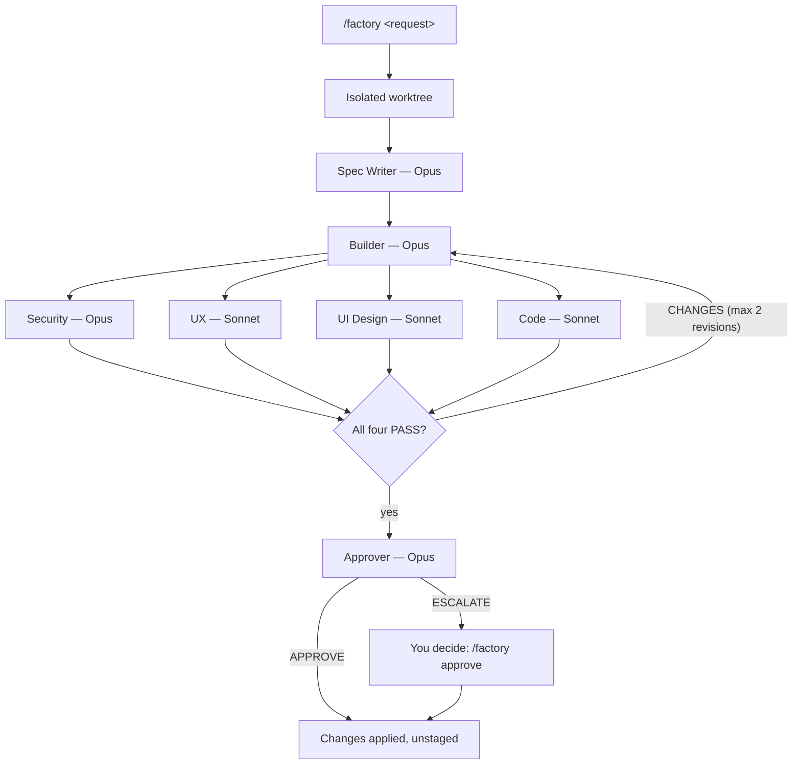

# Software Factory for Claude Code

A local, visual software factory as a Claude Code plugin. `/factory <feature request>` turns a request into a specification and plan, an implementation in an isolated Git worktree, four parallel reviews, up to two automatic revision rounds and an approval. The approved changes then land on your branch **uncommitted and unstaged**, ready for you to review and commit.

A localhost dashboard shows every stage, every agent's token usage and every file the run produced.



Not an official Anthropic project.

## Install

The factory depends on six other plugins. Claude Code installs them with it, as long as their marketplaces are added first:

```sh
claude plugin marketplace add anthropics/claude-plugins-official   # usually already added
claude plugin marketplace add forrestchang/andrej-karpathy-skills
claude plugin marketplace add Lum1104/Understand-Anything
claude plugin marketplace add Petrit-Halabaku/software-factory
claude plugin install factory@software-factory
```

Then run `/reload-plugins`, or start a new Claude Code session.

| Dependency | Used for |
|---|---|
| `superpowers` | brainstorming, plans, test-driven development, debugging, verification, receiving reviews |
| `feature-dev` | read-only helper agents: code explorer, code architect, second-opinion code reviewer |
| `frontend-design` | UI work and the UI design review |
| `andrej-karpathy-skills` | keeping changes small and assumptions explicit |
| `understand-anything` | optional codebase knowledge graph for impact analysis |
| `claude-code-setup` | installed for you; no factory stage uses it |

If one is missing or disabled later, `/factory` notices at the start of a run, installs or enables it, and asks you to reload.

**Requirements:** Claude Code with plugin dependencies and agent skill preloading (tested with 2.1.306), Git with worktree support, Node.js 20 or later, macOS or Linux.

## Set up a repository

In the repository you want to build in:

```text
/factory init
```

It adds one block to `.git/info/exclude` (never `.gitignore`), creates `factory/` for the factory's state, and writes `factory/house-rules.md` by inspecting your repository: languages and versions, test and lint commands, conventions, UI kit, auth helpers. It asks you only for what the code cannot say, such as paths that must never change. Edit `factory/house-rules.md` whenever the repository changes; every agent reads it before working.

## Use

| Command | What it does |
|---|---|
| `/factory init` | sets the factory up in the current repository |
| `/factory <feature request>` | starts a run |
| `/factory status` | run, stage, agents, reviews, revisions, approval, files, tokens, dashboard URL |
| `/factory approve [note]` | approves an escalated run and applies it after the Git safety checks |

If another skill in your setup is also called `factory`, use the plugin's full name: `/factory:factory init`.

The dashboard runs at `http://127.0.0.1:4100/` and starts with the first run. Specs, plans, build reports, reviews, approvals and every changed file open in a side drawer: Markdown preview, source with line numbers, diffs against the start or any earlier round.

## How it works

| Stage | Agent | Model | Preloaded skills | Helpers |
|---|---|---|---|---|
| Spec | `factory:spec-writer` | Opus | brainstorming, writing-plans, karpathy-guidelines, understand-explain | code-explorer, code-architect |
| Build | `factory:builder` | Opus | executing-plans, test-driven-development, systematic-debugging, verification-before-completion, receiving-code-review, karpathy-guidelines, frontend-design, simplify | none |
| Review | `factory:security` | Opus | verification-before-completion | none |
| Review | `factory:ux` | Sonnet | none | none |
| Review | `factory:ui-design` | Sonnet | frontend-design | none |
| Review | `factory:code` | Sonnet | code-review, verification-before-completion, karpathy-guidelines, understand-diff | code-reviewer |
| Approval | `factory:approver` | Opus | verification-before-completion, understand-diff | none |

The session that runs `/factory` is the orchestrator. It spawns the agents, decides from the files they write, never from their replies, and is the only thing that touches Git or the board. It does that through a small CLI (`bin/fac.mjs`), so every Git step is the same tested code.

Skills are preloaded through each agent's `skills:` frontmatter, so an agent never has to decide to use them. Where a skill would ask you a question, commit, push or open a PR, the factory's rules override it. The full rules are in [`plugins/factory/rules.md`](plugins/factory/rules.md).

## Safety

- **Your checkout is never built in.** Every run builds in `factory/worktrees/<run-id>/` on a local `factory/<run-id>` branch from your current commit. Your uncommitted changes are not part of the build, and the factory refuses to commit a round if the builder touched files in your checkout.
- **Nothing reaches Git history on your branch.** Rounds are committed only on the factory branch. Merge-back checks your branch, HEAD, the worktree, the exclusions and the patch, then runs `git apply --check` and `git apply`, working tree only. Your index and HEAD are verified unchanged afterwards. Nothing is ever pushed.
- **Factory files stay out of Git.** Everything lives in `factory/`, ignored through `.git/info/exclude`, and every run checks that nothing there is tracked or staged.
- **Secrets stay out.** Rounds and patches with secret-looking paths or credential-looking lines are refused. Reports name files and lines, never values.
- **The dashboard is local and read-only.** It binds to 127.0.0.1, serves registered artifacts by id only, and refuses path traversal, symlinks, secret files and oversized files.

## Token monitoring

The dashboard reads Claude Code's local session records for the repository, read-only, from every profile that has them (`~/.claude/projects/…`, `~/.claude-<name>/projects/…`). Usage is attributed per model, per agent (orchestrator separate), per stage and per round, for the current run, a local 5-hour window, 24 hours, 7 days or all history. Each API message counts once. Only ids, model names, timestamps and token counters are stored, never prompt text. Plan quotas are shown as *Unavailable*, because no local source reports them.

## Configuration

`factory/config.json` in your repository overrides the plugin's defaults:

| Key | Default | Meaning |
|---|---|---|
| `worktree.links` | `["node_modules"]` | dependency directories symlinked into each worktree (for example add `"apps/web/node_modules"`) |
| `revisionMax` | `2` | automatic revision rounds before escalation |
| `dashboard.port` | `4100` | dashboard port |
| `usage.sources` | found automatically | session-record directories to read |
| `usage.pricing` | `null` | USD per million tokens per model family, to show cost estimates |

## Uninstall

```sh
claude plugin uninstall factory@software-factory
```

In each repository you used it in: delete `factory/`, remove any `factory/*` branches, and drop the "CLAUDE CODE SOFTWARE FACTORY" block from `.git/info/exclude`.

## Development

```sh
node --test plugins/factory/test/*.test.mjs
claude plugin validate .
```

Tests run against scratch repositories in the system temp directory, never your checkout. To try local changes, run `claude --plugin-dir plugins/factory` in a scratch repository.

## License

MIT
